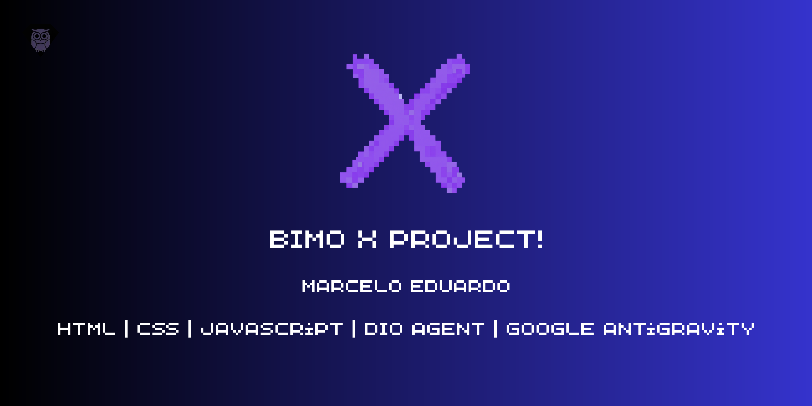
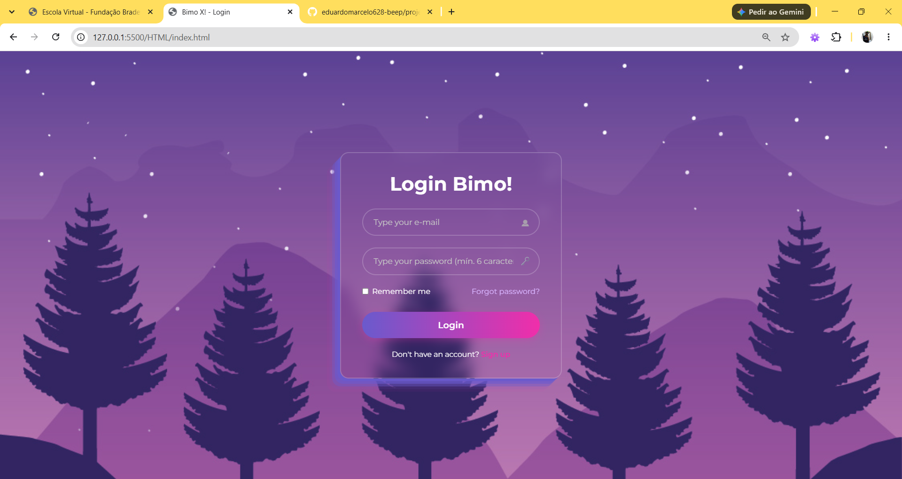

<div align="center">



# 🌌 Bimo X

### Aprenda programação do zero, no seu ritmo, direto ao ponto.

Uma plataforma de estudos para quem está dando os primeiros passos no mundo da programação, com artigos curtos, exemplos comentados e acompanhamento de progresso.

[](https://eduardomarcelo628-beep.github.io/projeto-BimoX/)


</div>

---

## 🌐 Acesse agora

O Bimo X está publicado e pronto para usar, sem instalar nada:

👉 **[eduardomarcelo628-beep.github.io/projeto-BimoX](https://eduardomarcelo628-beep.github.io/projeto-BimoX/)**

Crie uma conta com qualquer e-mail e comece a estudar!

---

## 📖 Sobre o projeto

O **Bimo X** nasceu como um projeto pessoal de estudo: eu queria construir algo completo, com **login, cadastro, conteúdo, progresso do usuário e um painel administrativo**, usando só as tecnologias base da web (HTML, CSS e JavaScript).

A ideia da plataforma é simples: ser um cantinho tranquilo (e bonito 💜) para quem está começando a programar encontrar conceitos fundamentais explicados de forma direta, com códigos comentados e guias práticos, 100% gratuito.

> Este projeto foi desenvolvido com o auxílio do **DIO Agent**, através do **Google Antigravity**, como parte da minha jornada de aprendizado na [DIO](https://www.dio.me/). Revisar, entender e ajustar o que foi gerado foi uma parte importante do processo.

---

## ✨ Funcionalidades

### 👩‍🎓 Para o usuário

- 🔐 **Cadastro e login** com e-mail e senha (mínimo de 6 caracteres)
- 📚 **Explorar artigos** organizados por categoria: Fundamentos, Front-End, Back-End e Banco de Dados
- 🔎 **Busca** por tema, conceito ou tecnologia (ex.: `loops`, `sql`, `css`)
- ✅ **Marcar artigos como lidos**
- 📈 **Barra de progresso** com o andamento dos estudos (ex.: "3 de 7 concluídos")
- ⏱️ **Tempo estimado de leitura** em cada artigo

### 🛠️ Para o administrador

- 👥 **Painel de usuários** com todos os alunos cadastrados
- 📊 **Métricas gerais**: total de usuários, artigos na plataforma e artigos concluídos
- 🕒 Acompanhamento de **data de cadastro, último login e progresso de leitura** de cada aluno
- 🗑️ **Exclusão de usuários** (a conta de admin é protegida contra exclusão)
- 📥 **Exportação dos dados em CSV**

---

## 🖼️ Telas

| Login | Explorar artigos |
|:---:|:---:|
|  |  |

| Painel administrativo |
|:---:|
|  |

---

## 📚 Conteúdos disponíveis

| Categoria | Artigos |
|---|---|
| 📦 Fundamentos | Variáveis e Tipos de Dados · Estruturas Condicionais (if / else) · Laços de Repetição (for, while) |
| 🎨 Front-End | HTML5 Semântico e CSS Moderno · Manipulação do DOM com JavaScript |
| ⚙️ Back-End | O que são APIs REST e Protocolo HTTP |
| 🗄️ Banco de Dados | Bancos de Dados: SQL e modelagem |

Os artigos ficam todos centralizados em `data/articles.js`, então adicionar um conteúdo novo é só incluir um novo item na lista.

---

## 🧰 Tecnologias utilizadas

- **HTML5**: estrutura semântica das páginas
- **CSS3**: layout responsivo, efeitos de vidro (glassmorphism) e o tema roxo/estrelado
- **JavaScript (Vanilla)**: lógica de autenticação, progresso, busca, filtros e painel admin
- **Supabase**: base para a camada de autenticação/dados (ver `js/supabase-auth.js`)
- **GitHub Pages**: hospedagem do site

---

## 📁 Estrutura de pastas

```
projeto-BimoX/
├── css/
│   ├── article.css        # Estilos da página de leitura
│   ├── dashboard.css      # Estilos da tela de artigos e do painel admin
│   └── styles.css         # Estilos gerais e da tela de login
├── data/
│   └── articles.js        # "Banco de dados" dos artigos
├── HTML/
│   ├── index.html         # Login e cadastro
│   ├── dashboard.html     # Explorar artigos
│   ├── article.html       # Leitura de um artigo
│   └── admin.html         # Painel administrativo
├── img/                   # Imagens, ícones e planos de fundo
├── js/
│   └── supabase-auth.js   # Autenticação, sessão, progresso e regras de acesso
├── index.html             # Redireciona para HTML/index.html (necessário para o GitHub Pages)
├── LICENSE
└── README.md
```

---

## 🚀 Como rodar localmente

Prefere rodar na sua máquina? Não precisa instalar nada! 🎉

1. **Clone o repositório**
   ```bash
   git clone https://github.com/eduardomarcelo628-beep/projeto-BimoX.git
   ```
2. **Abra a pasta do projeto** e dê dois cliques em `index.html` (ou em `HTML/index.html`) para abrir no navegador.

💡 *Dica:* se você usa o VS Code, a extensão **Live Server** deixa tudo mais agradável: clique com o botão direito em `HTML/index.html` → **Open with Live Server**.

3. **Crie uma conta** na opção *Sign up* e comece a estudar!

---

## 🔒 Nota sobre segurança

Este é um **projeto educacional**. Como tudo roda no navegador (front-end), as regras de autenticação e de acesso ao painel admin também rodam no lado do cliente, o que significa que **não são adequadas para um ambiente de produção com dados reais**.

Na prática, um sistema de verdade validaria login, permissões e dados em um **back-end**, e esse é um dos próximos passos da minha evolução. 🌱

Por isso, **não use no Bimo X uma senha que você usa em outros lugares**.

---

## 🛣️ Próximos passos (roadmap)

- Migrar a autenticação e as permissões de admin para um back-end seguro
- Salvar o progresso dos usuários em um banco de dados na nuvem
- Recuperação de senha funcional
- Mais artigos: Python, Java, Git e GitHub
- Modo claro / escuro
- Certificado de conclusão ao finalizar todos os artigos

---

## 🌱 O que eu aprendi

Construir o Bimo X me ajudou a praticar, na prática:

- Organização de um projeto em múltiplas páginas, pastas e responsabilidades
- Manipulação do DOM, eventos e persistência de estado
- Fluxos de cadastro, login e sessão
- Diferença entre o que é **controle de acesso real** e o que é apenas **interface**
- Uso de Git e GitHub para versionar, publicar e hospedar o projeto no GitHub Pages
- Como trabalhar com um agente de IA: pedir, ler o resultado, questionar e ajustar

---

## 🤝 Contribuições

Sugestões, ideias e feedbacks são muito bem-vindos! Fique à vontade para abrir uma *issue* ou enviar um *pull request*.

---

## 📄 Licença

Distribuído sob a licença **MIT**. Veja o arquivo [LICENSE](LICENSE) para mais detalhes.

---

<div align="center">

Feito com 💜 e muita curiosidade por **Marcelo Eduardo**

[](https://github.com/eduardomarcelo628-beep)

</div>